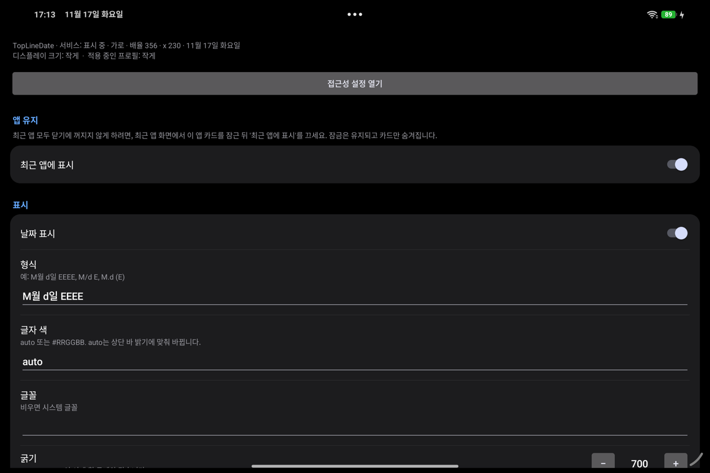

# TopLineDate

English | [한국어](README.ko.md)

An Android app that shows the date and weekday next to the status bar clock. No root required.


> **Released with settings tuned for the OPPO Pad mini.** It works on other Android devices too, but
> defaults such as text size, position and animation timing are tuned for the OPPO Pad mini
> (ColorOS 17). On other devices, fine-tune them under **Size and position** in the settings.

Made for devices like ColorOS that have no option to show the date in the status bar. Apps that draw the date into a notification icon don't work there, because ColorOS replaces notification icons with the app icon. TopLineDate instead draws the text right next to the clock with an accessibility overlay.

## Features

- **Follows the clock.** It finds the clock itself and sits right next to it. When notification icons appear it moves behind them, and it follows when the system shifts the status bar slightly for burn-in protection.
- **Moves with the clock.** Timing and speed were matched to the clock frame by frame on screen recordings.
  - Entering fullscreen, it slides up and hides with the clock; leaving fullscreen, it drops back in with it.
  - When you pull down the top edge in fullscreen to peek at the clock, it drops in and goes back with it.
  - After unlock, it brightens at the same rate, right when the clock appears.
  - It hides with the clock on the recents screen, the notification shade and the lock screen.
- **Tells screen situations apart.** Split screen, floating windows and their three-dot menu, the keyboard, and rotations while apps open and close can make the status bar look ambiguous. Each case is handled separately so the date never blinks or lingers on its own.
- **Snaps into place on rotation.** It remembers where the clock sits in portrait and landscape, and moves straight to the new spot while rotating, over an app or on the home screen.
- **Automatic text color.** Switches between light and dark text to match the status bar brightness of each app.
- **Per display size settings.** Size and position are saved separately for each display size (Small, Default and so on) and applied automatically.
- **Follows the system language.** The UI is in Korean when the device language is Korean, and in English for every other language. The default date format in the status bar follows the language too.
- **No internet permission.** It sends no data anywhere.

## Requirements

- Android 11 or later
- Tuned for: OPPO Pad mini (OPD2515), ColorOS 17, China ROM
  - Ships with defaults for two display sizes, "Small" and "Default", applied automatically according to the current display size.
- Other devices: it works, but needs fine-tuning. Status bar height and clock font and size differ by device, so adjust these under **Size and position** in the settings.
  - Text size, weight
  - Gap to clock, gap to notification icons
  - Portrait and landscape height (including fine height)
- On devices with a very different status bar layout, it may not find the clock automatically. In that case turn off **Attach to the clock automatically** and set the X position yourself.

## Installation and setup

### 1. Install

Download `TopLineDate.apk` from [Releases](../../releases) and install it. Allow "install unknown apps" if asked.

### 2. Allow restricted settings

Since Android 13, sideloaded apps cannot turn on accessibility right away.

Settings → Apps → App management → TopLineDate → menu at the top right (⋮) → **Allow restricted settings**

On ColorOS this may be labeled "Remove permission restrictions".

### 3. Turn on accessibility

Open TopLineDate, tap **Open accessibility settings**, then turn on Downloaded apps → TopLineDate.

### 4. Keep it out of recents cleanup (recommended on ColorOS)

On ColorOS, "Close all" in recents force-stops background apps. Android then also disconnects the accessibility service.

1. With the TopLineDate settings screen open, go to the recents screen.
2. **Lock** the TopLineDate card.
3. Go back to the settings screen and turn off **Show in recents**. The lock stays; only the card is hidden.

It also helps to allow **Auto launch** and **Background activity** for TopLineDate in the ColorOS settings.

### 5. Recommended: notification icon style

Settings → Notifications & quick settings → Status bar → set notification icons to **Number** or **Don't show**.

It also works with **Icons** without overlapping, but the date position keeps changing with the number of notification icons.

### 6. (Optional) Auto-recovery permission

With a PC and ADB you can grant one more permission. Then, even if the app is force-stopped and accessibility turns off, opening TopLineDate once turns accessibility back on automatically.

```sh
adb shell pm grant io.github.dqot.toplinedate android.permission.WRITE_SECURE_SETTINGS
```

If ColorOS throws a `SecurityException`, turn on **Disable System Optimization** in Developer options and run it again. This option may only be visible when the system language is English.

## Settings



| Card | Contents |
|---|---|
| Keep running | Show in recents |
| Display | Show date, format, text color, font, weight |
| Size and position | Display size profile (Auto, Small, Default), text size, gap to clock, gap to notification icons, height adjustments |
| Notification icons | Send test notification, move time when notification icons appear or go |
| Hiding | Hide in fullscreen, hide when the clock hides, show early when leaving fullscreen |
| Animation and timing | Drop-in and slide-up times for fullscreen, drop-in time in split screen, fades, rotation, returning from recents, after unlock |
| Labs | Landscape in fullscreen (see below) |

**Format** is a Java [SimpleDateFormat](https://developer.android.com/reference/java/text/SimpleDateFormat) pattern. The default is `M월 d일 EEEE` in Korean; in other languages it is that language's short month, day and weekday format (`EEE, MMM d` in English, e.g. Thu, Nov 26).

| Format | Shows |
|---|---|
| `EEE, MMM d` | Tue, Nov 17 |
| `M/d E` | 11/17 Tue |
| `EEEE, MMMM d` | Tuesday, November 17 |
| `M월 d일 EEEE` | 11월 17일 화요일 (Korean) |

Changes show in the status bar right away. Values in the **Size and position** card are saved to the currently selected display size profile. The animation and timing defaults were measured from screen recordings on the OPPO Pad mini.

## Labs

**Labs**, at the bottom of the settings, holds experimental features separate from the date. They are off by default.

**Landscape in fullscreen**: when a chosen app (YouTube and Netflix by default) goes fullscreen, the screen is locked to landscape; when fullscreen ends or you switch to another app, the original rotation setting is restored. Meant for apps like YouTube for tablets that don't rotate to landscape on their own, even in fullscreen.

- Since Android 16, apps' orientation requests are ignored on large screens, so it works by briefly setting the system rotation lock to landscape.
- While locked to landscape, it still follows when you turn the tablet to the opposite landscape side.
- The **Modify system settings** permission must be allowed on the Labs screen.
- The original rotation setting (auto-rotate on or off, orientation) is saved and restored as it was. If the app crashes, it is restored on the next start; if the same app is still fullscreen right after an update, the lock simply carries on.

## Permissions and privacy

| Permission | Used for |
|---|---|
| Accessibility service | Drawing the date over the status bar, checking window position and size, locating the status bar clock and the icons beside it |
| Accessibility screenshot | In automatic text color mode, checking only the status bar brightness when the app changes |
| Notifications | The test notification button on the settings screen |
| Write secure settings (optional, ADB) | Turning accessibility back on after it was switched off |
| Modify system settings (Labs, optional) | Briefly setting the rotation lock to landscape in fullscreen |

- It reads no screen content other than the status bar.
- Screenshots are used in memory only to compute brightness and are discarded right away. They are never saved or sent.
- No internet permission.

## Known limitations

The date moves with the status bar changes the system reports. When the system does not report them in advance, it lags slightly behind the clock.

- **Split screen**: the system reports the status bar only after it has fully dropped in, so the date appears slightly after the clock. When hiding, it follows the bar up from wherever the bar is mid-slide.
- **Apps that fade the status bar out in place (e.g. Ridi)**: the moment the fade starts can't be detected, so the date disappears after the clock has fully gone.
- **Entering the notification shade and the recents screen**: the signal arrives after the clock starts fading, so the date disappears about 0.1 s late.
- It may not find the clock on other manufacturers' status bar layouts. In that case turn off **Attach to the clock automatically** and set the X position yourself.

## License

[MIT](LICENSE)
